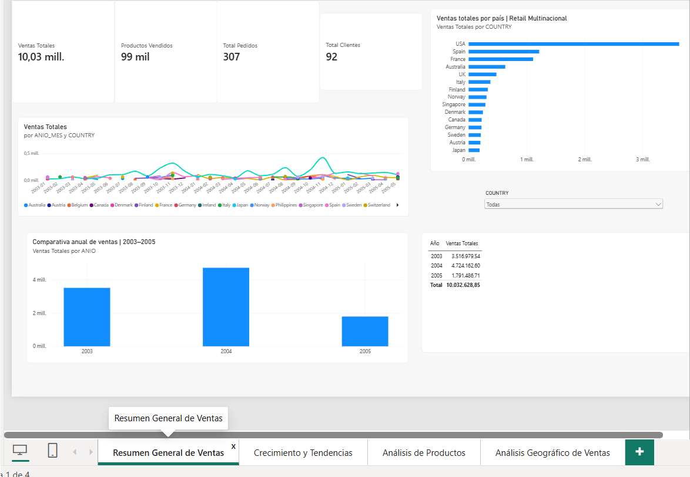
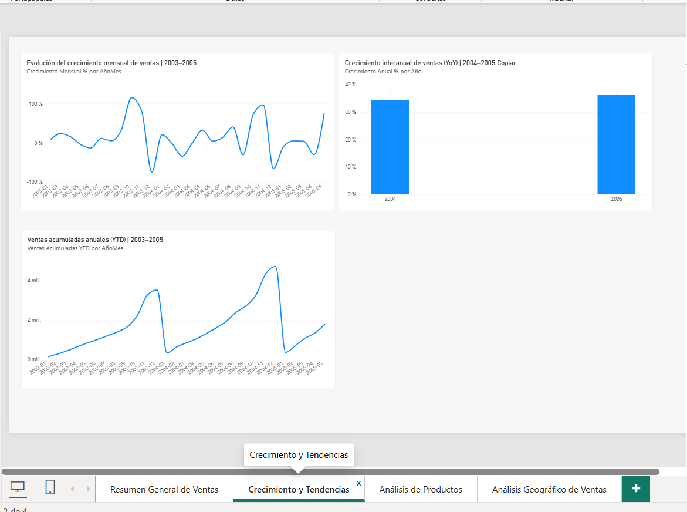
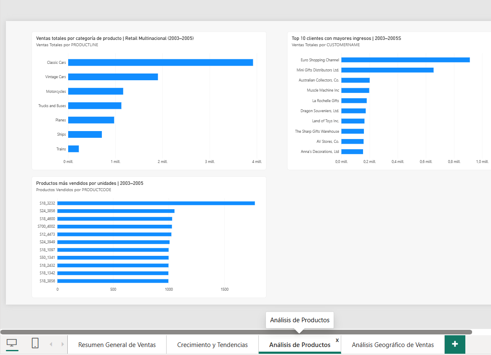
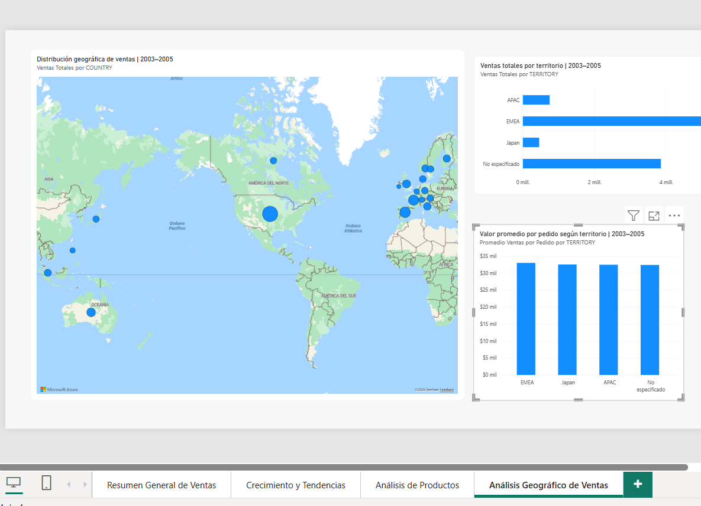
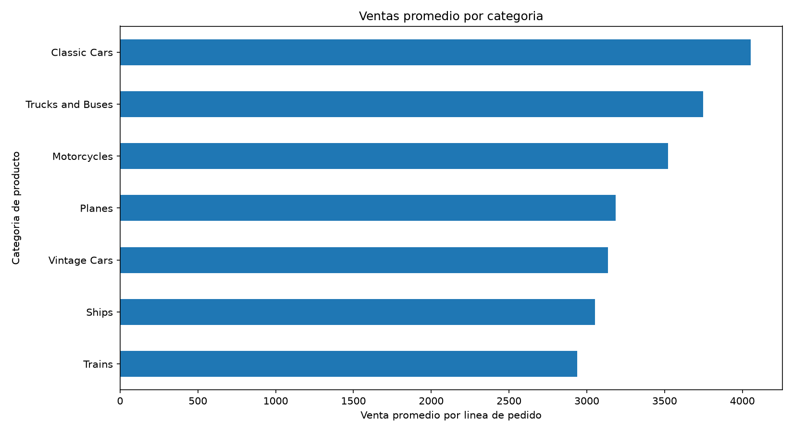
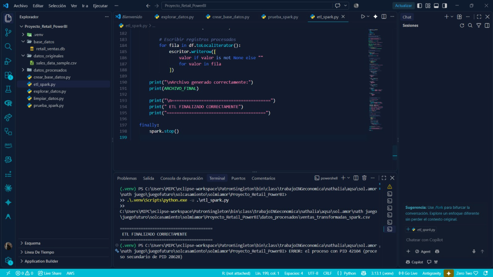
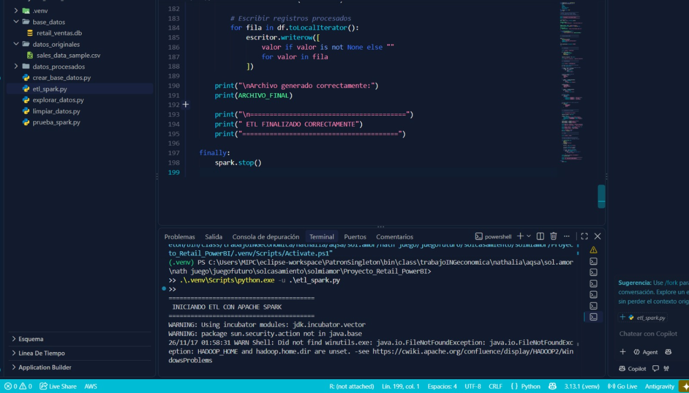
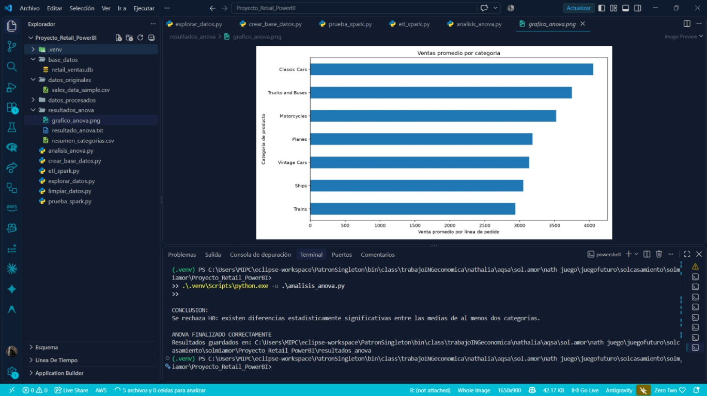
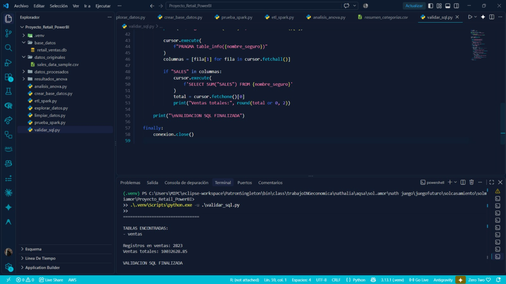
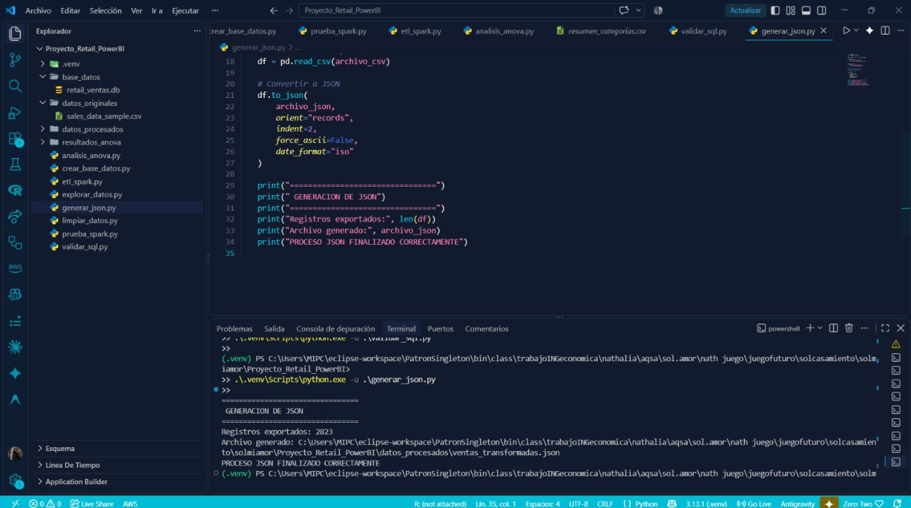

# Proyecto de análisis de ventas Retail con Power BI, Python, Spark y SQL

Proyecto académico de análisis de ventas de una empresa retail multinacional. Incluye exploración y limpieza de datos con Python, una segunda transformación ETL con Apache Spark, almacenamiento en SQLite, exportación a JSON, un análisis ANOVA y un informe de Power BI.

> **Alcance de las cifras:** los resultados que se muestran abajo se obtuvieron de los archivos incluidos en este repositorio y de las capturas guardadas en `evidencias/`. Las imágenes son evidencia visual del informe, pero no permiten validar por sí solas la actualización del modelo de Power BI.

## Contenido

- [Objetivos](#objetivos)
- [Tecnologías](#tecnologías)
- [Estructura del proyecto](#estructura-del-proyecto)
- [Datos y proceso](#datos-y-proceso)
- [Evidencias y resultados](#evidencias-y-resultados)
- [Instalación y ejecución](#instalación-y-ejecución)
- [Limitaciones y consideraciones](#limitaciones-y-consideraciones)

## Objetivos

- Explorar la estructura y calidad del conjunto de datos de ventas.
- Preparar datos limpios y columnas de apoyo para el análisis temporal.
- Transformar datos con un flujo ETL local de Apache Spark.
- Guardar y consultar los datos desde SQLite y exportarlos a JSON.
- Comparar las ventas promedio por línea de producto mediante ANOVA.
- Presentar indicadores y gráficos interactivos en Power BI.

## Tecnologías

- **Python**: scripts de exploración, ETL, validación y análisis.
- **Pandas**: lectura, limpieza y transformación de datos.
- **Apache Spark / PySpark**: transformación distribuida en modo local.
- **SQLite**: almacenamiento relacional en un archivo local.
- **SciPy y Matplotlib**: pruebas estadísticas y gráfico de resultados.
- **Power BI Desktop**: informe (`proyecto (1).pbix`) y páginas del dashboard.

## Estructura del proyecto

```text
Proyecto_Retail_PowerBI/
├── analisis_anova.py
├── crear_base_datos.py
├── etl_spark.py
├── explorar_datos.py
├── generar_json.py
├── limpiar_datos.py
├── prueba_spark.py
├── validar_sql.py
├── proyecto (1).pbix
├── datos_originales/
│   └── sales_data_sample.csv
├── datos_procesados/
│   ├── ventas_limpias.csv
│   ├── ventas_transformadas_spark.csv
│   └── ventas_transformadas.json
├── base_datos/
│   └── retail_ventas.db
├── resultados_anova/
│   ├── grafico_anova.png
│   ├── resultado_anova.txt
│   └── resumen_categorias.csv
└── evidencias/
    ├── ANOVA/
    ├── Ejecucion/
    ├── PowerBI/
    ├── Spark_ETL/
    └── SQL_JSON/
```

## Datos y proceso

El archivo de entrada es `datos_originales/sales_data_sample.csv`. Contiene **2.823 filas y 25 columnas**, con campos de pedidos, fechas, productos, ventas, clientes y ubicación. En los datos incluidos, las fechas van del **6 de enero de 2003 al 31 de mayo de 2005**.

> **Para que las imágenes se vean en GitHub:** sube el archivo `README.md` junto con la carpeta completa `evidencias/`, conservando su estructura. Si copias el README a otra ubicación, ajusta las rutas de imágenes para que sigan apuntando a esa carpeta.

El proyecto tiene dos transformaciones que parten del CSV original y producen resultados distintos:

1. **Limpieza con Pandas** (`limpiar_datos.py`): elimina duplicados exactos, convierte `ORDERDATE`, quita espacios en columnas de texto, completa valores vacíos de `STATE` y `TERRITORY` con `No especificado`, y agrega `ANIO`, `MES`, `TRIMESTRE`, `ANIO_MES` e `ID_LINEA_VENTA`. El resultado es `datos_procesados/ventas_limpias.csv`.
2. **ETL con PySpark** (`etl_spark.py`): elimina duplicados, recorta espacios, convierte campos numéricos y fechas y descarta filas sin `ORDERNUMBER`, `ORDERDATE` o `SALES`. Se ejecuta localmente (`local[2]`) y genera `datos_procesados/ventas_transformadas_spark.csv`.

Los siguientes scripts usan estos resultados:

- `crear_base_datos.py` carga el CSV limpio de Pandas en `base_datos/retail_ventas.db`, en la tabla `ventas`.
- `validar_sql.py` consulta las tablas y valida conteos y ventas totales de la base SQLite.
- `generar_json.py` convierte el resultado de Spark a `datos_procesados/ventas_transformadas.json`.
- `analisis_anova.py` agrupa `SALES` por `PRODUCTLINE`, evalúa homogeneidad de varianzas con Levene y guarda el resumen, el informe y la gráfica en `resultados_anova/`.
- `explorar_datos.py` imprime información descriptiva y controles básicos de calidad; no genera un archivo de salida.
- `prueba_spark.py` ejecuta una comprobación pequeña de que Spark puede iniciar y procesar un rango.

## Evidencias y resultados

### Informe de Power BI

El archivo Power BI contiene páginas de resumen, tendencias, productos y análisis geográfico. Las imágenes siguientes son capturas incluidas en el repositorio:

#### 1. Resumen general de ventas



La captura presenta indicadores generales, comparativa anual y ventas por país. En la imagen se muestran ventas totales de aproximadamente **10,03 millones**, **307 pedidos** y **92 clientes**.

#### 2. Crecimiento y tendencias



#### 3. Análisis de productos



#### 4. Análisis geográfico



### ETL con Spark y salida SQL/JSON

Se incluyen copias de evidencia y resultados relacionados en `evidencias/Spark_ETL/` y `evidencias/SQL_JSON/`. Los resultados de datos que están en la raíz del proyecto incluyen el CSV procesado por Spark, el JSON exportado y la base SQLite.

En los archivos incluidos, la base SQLite contiene una tabla `ventas` con **2.823 filas** y una suma de `SALES` de **10.032.628,85**. El CSV de Spark también contiene 2.823 filas. La tabla SQLite se genera desde el CSV limpio de Pandas, no desde el CSV de Spark.

### Análisis ANOVA

El reporte incluido en `resultados_anova/resultado_anova.txt` registra una prueba de Welch:

- **Estadístico F:** 27,0272
- **Valor p:** 7,0908 × 10⁻²⁹
- **Conclusión del análisis:** se rechaza la hipótesis nula de igualdad de todas las medias; hay evidencia de que al menos dos líneas de producto tienen ventas promedio distintas.
- La categoría con mayor venta promedio por línea en el resumen incluido es **Classic Cars** (aproximadamente **4.053,38**).

La prueba evalúa diferencias globales entre grupos; no identifica por sí sola qué pares de categorías difieren.



La gráfica generada también está disponible en `resultados_anova/grafico_anova.png`; el texto y el resumen por categoría se guardan en esa misma carpeta.

### Capturas de ejecución

Las siguientes capturas muestran ejecuciones en la terminal de VS Code. Son evidencia del entorno en el que se ejecutaron los scripts; en particular, las advertencias de Spark y el mensaje de proceso de Windows se conservan aquí para mostrar también las limitaciones observadas.

#### ETL de Spark

La consola muestra el inicio de Spark y advertencias de Hadoop sobre `winutils.exe` y la configuración de `HADOOP_HOME`. En otra ejecución se ve el mensaje de finalización del ETL y la ruta del CSV generado, seguido de un error del proceso secundario de Windows. Por ello, el mensaje de finalización del script no demuestra por sí solo que el proceso haya terminado sin incidencias.





#### Análisis ANOVA

La primera captura muestra la gráfica de ventas promedio por categoría y la ejecución del análisis. La segunda muestra la conclusión impresa por el script: se rechaza H0 y se reportan diferencias estadísticamente significativas entre las medias de al menos dos categorías.




#### Validación SQL y exportación JSON

La validación de SQLite muestra la tabla `ventas`, sus 2.823 registros y ventas totales de 10.032.628,85. La captura de JSON muestra la exportación de 2.823 registros y el mensaje de finalización del proceso.





## Instalación y ejecución

Se requiere **Python 3**. El ETL de Spark requiere además **Java** y PySpark. Las versiones de Python, Java y las bibliotecas no están fijadas en un archivo de dependencias, por lo que deben ser compatibles entre sí. Para abrir el informe se necesita **Power BI Desktop**.

Desde la carpeta del proyecto, en PowerShell:

```powershell
py -m venv .venv
.\.venv\Scripts\Activate.ps1
python -m pip install pandas matplotlib scipy pyspark
```

Ejecuta los scripts en este orden para generar los archivos que dependen unos de otros:

```powershell
python explorar_datos.py
python limpiar_datos.py
python etl_spark.py
python crear_base_datos.py
python validar_sql.py
python generar_json.py
python analisis_anova.py
```

`crear_base_datos.py` requiere que antes se haya generado `ventas_limpias.csv`; `generar_json.py` y `analisis_anova.py` requieren que Spark haya generado `ventas_transformadas_spark.csv`. Los scripts escriben sus resultados en las carpetas del proyecto. Para revisar el dashboard, abre `proyecto (1).pbix` con Power BI Desktop.

## Limitaciones y consideraciones

- **Dependencias no fijadas:** no se incluye `requirements.txt` ni un archivo de bloqueo. La instalación indicada es orientativa; la ejecución de Welch requiere una versión de SciPy que acepte `equal_var=False` en `scipy.stats.f_oneway`.
- **Ejecución local:** Spark se configura con `local[2]`; este proyecto no configura un clúster ni prueba rendimiento a gran escala.
- **Dos salidas ETL:** Pandas y Spark aplican reglas diferentes. Pandas agrega columnas de calendario e identificador; la transformación Spark elimina filas con campos esenciales vacíos. Por eso sus esquemas y datos de salida no son intercambiables.
- **Datos faltantes:** el CSV original tiene valores vacíos en `STATE` (1.486 filas en el archivo revisado). La limpieza completa `STATE` y `TERRITORY`, pero conserva otros faltantes; el flujo Spark puede descartar registros si falta alguno de sus campos esenciales.
- **Alcance temporal:** los datos terminan en mayo de 2005 y no representan necesariamente ventas actuales ni años completos comparables.
- **Análisis estadístico:** ANOVA detecta diferencias globales entre medias, pero el proyecto no incluye pruebas post hoc que indiquen qué categorías difieren. La interpretación también depende de los supuestos y de la unidad observada (línea de pedido).
- **Power BI:** las capturas prueban el aspecto de las páginas incluidas, pero no documentan por sí solas el modelo, las medidas DAX, las relaciones ni una actualización reproducible desde otra computadora. Puede ser necesario reconfigurar las rutas del origen al abrir el `.pbix`.
- **Sin pruebas automatizadas:** los scripts incluyen algunas comprobaciones y aserciones, pero no se encontró una suite de pruebas automatizadas ni integración continua.
- **Origen y distribución de datos:** el repositorio no documenta la licencia ni la procedencia original del CSV. El archivo incluye nombres y datos de contacto/dirección; antes de publicar o redistribuir el conjunto de datos, verifica que tengas permiso y considera anonimizar la información.
- **Moneda y contexto de negocio:** no se documentan en el proyecto la moneda, la zona horaria ni reglas de negocio para interpretar las ventas; no deben asumirse a partir de las cifras únicamente.
